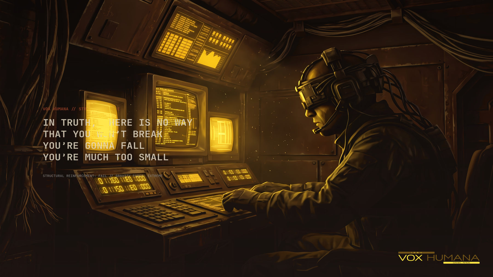

# Vox Humana Theme for Omarchy



A dark, dystopian, yet whimsical theme for [Omarchy](https://omarchy.org/) Linux systems, inspired by the profound existential lyrics of *"Incredible Shrinking Man"* and styled with a custom dark-mustard and rust-red color palette.

## Features

- **Extracted Color Palette:** Beautifully tailored shades of deep, warm charcoal (`#201713`), vibrant gold/yellow (`#e5a221`), rust-red (`#a8472a`), and soft vintage cream white (`#e5dac5`).
- **Custom Mustard Folders:** Fully integrated folder icons using `Tela-circle-yellow-dark` colorized specifically in dark mustard (`#725418`).
- **20 Beautiful 4K Wallpapers:** Including 10 processed lyric-themed wallpapers and 10 unique, abstract, dystopian layouts built with high-fidelity vector art.
- **Custom GTK3/GTK4/Libadwaita Stylesheet:** Explicitly fixes dialogue box contrast and button readability issues, providing perfectly legible dialog text on dark surfaces with sharp-cornered terminal dashboard styles.

## Installation

You can install the theme directly onto your Omarchy system with a single command:

```bash
omarchy theme install https://github.com/techaeris/omarchy-vox-humana-theme
```

## Activation

To apply the theme:
1. Open the Omarchy Style menu using **`Super + Space`** (or search **Style** in the launcher).
2. Go to **Theme** and select **`vox-humana`**.

Alternatively, you can activate it via the command line:

```bash
omarchy theme set "Vox Humana"
```

To cycle through the 20 included 4K wallpapers:

```bash
omarchy theme bg next
```

## License

This project is licensed under the MIT License - see the [LICENSE](LICENSE) file for details.
